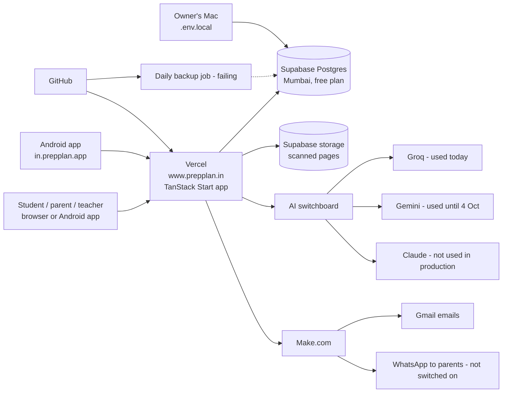

# PrepPlan: where we are (discovery report, 2026-11-04)

Read-only audit of the repo, the production database (SELECT counts only), Vercel deployments, GitHub
Actions and the live site. Nothing was edited, committed, pushed, migrated or seeded. Where a document
and reality disagree, this report goes with reality and lists the disagreement in section 7.

---

## 1. At a glance

1. **The product is live and in use.** www.prepplan.in is up. 144 people have accounts: 63 students who signed up on their own, 21 older student logins, 24 parents, 31 school students, 4 teachers and 1 admin. 182 papers have been made, 76 of them in the last 30 days. The last paper was on 1 November.
2. **The question bank is large.** It holds 40,209 approved questions across Classes 6–12 and UPSC Polity. Every real chapter has its full 20 questions per topic. Class 10 Science, most of Class 10 Social Science, Class 11–12 Chemistry and Biology, and all English and Telugu are still empty.
3. **There is no backup of the database. This is the biggest risk.** The daily backup job has failed all 35 times it has run because two GitHub secrets were never added. Supabase's free plan keeps no copy of its own.
4. **The AI in production is Groq, not Claude.** Since 6 October every AI call has gone to a free Groq model; before that it used Google Gemini. Claude has never been used in production. The privacy page still says Gemini is the main AI provider.
5. **The AI cost meter reads Rs 0.00 for all 117 calls.** Non-Claude providers are priced at zero, so the spending limit cannot see any real spend.
6. **The backlog is about 86% done.** 143 of 166 features are Done, 11 are In Progress and 12 are Not Started. Most of what is left needs you rather than code: legal review, accounts, real test papers and payments.
7. **The Schools module is built and deployed.** One demo school and one other school exist in production. It is not ready for a real paying school: the school terms text is still empty, the 5% teacher spot-check is not built, and no real marking run has happened in production.
8. **The Android app is not on the Play Store yet.** The app shell exists. Every remaining step is yours: create the signing key, add the GitHub secrets, set up the Play Console, find 12 testers for a 14-day closed test, and make the store graphics.
9. **The automatic tests are red.** CI has failed since 29 October because of one style error and 3 school screen tests. On this Mac, 729 unit tests pass and 2 fail, and both failures come from an out-of-date local test database.
10. **Four finished commits are only on this Mac.** One of them is F154, "the school's own questions". It needs a push, plus your go-ahead to run migration 0103 on production.

---

## 2. Architecture

| Layer | What we use | Status | Notes |
|---|---|---|---|
| Web app (screens + server) | TanStack Start 1.168, React 19.2, TypeScript, Vite 8 | Running | One codebase serves the website, the API and the Android app (the app is the website in a wrapper) |
| Look and feel | Tailwind 4.1, shadcn/ui ("new-york" style), lucide icons | Running | |
| Database access | Kysely 0.29 over the `pg` driver | Running | Connection pool kept very small (2 + 1) after an October outage |
| Login | better-auth 1.7 | Running | Email + password (no email check), Google sign-in (only if Google keys are set), "Try as guest". New sign-ups can only be students; schools sign up on their own page. No WhatsApp login (that work sits unmerged in PR #37) |
| Hosting | Vercel project `examprep-ai`, domain www.prepplan.in (bare prepplan.in redirects there) | Running | Last production deploy: 2026-11-04 06:30 IST, commit d5ada51 |
| Production database | Supabase, Mumbai region, free plan | Running | 105 tables; 101 migrations applied, up to 0102. The repo has 0103 waiting (not pushed yet) |
| Local development database | `.env.local` | **Points at the production database** | There is no separate dev database, so running the app or a script on this Mac touches real data |
| Test database | Local Postgres on this Mac | Out of date | Stuck at migration 0077 (an abandoned WhatsApp-login migration), so tests that use it are unreliable |
| AI | One switchboard that can call 5 vendors: Groq, Cerebras, Anthropic (Claude), OpenRouter, Gemini, tried in that order | **Production uses Groq** (gpt-oss-120b) | Reading photos (handwriting, school answer sheets) can only use Claude or Gemini; whether production has either key could not be checked |
| PDF papers | Headless Chrome on Vercel (playwright-core + @sparticuz/chromium) | Running | A timeout on large PDFs was diagnosed; the fix is waiting for approval |
| Word (.docx) papers | `docx` library | Built, schools only | Never opened in real Microsoft Word or Google Docs |
| Email | Make.com webhook → Gmail | Built | Works only if the Make webhook address is set in Vercel (could not check) |
| WhatsApp | Mastery share by WhatsApp link (students); school-to-parent messaging through Make.com + Meta | Share live; school messaging built but switched off | School messaging needs your Make/Meta setup and a 30-minute timer that needs Vercel Pro |
| Scheduled jobs | Vercel crons: weekly summary, daily nudge | Configured | Both need `CRON_SECRET` in Vercel (could not check) |
| Photo storage | Private Supabase storage bucket | Built | Production refuses uploads unless the Supabase storage keys are set |
| Backups | GitHub Action, daily encrypted copy | **Never worked** | 35 of 35 runs failed: secrets missing |
| Android | Trusted Web Activity, package `in.prepplan.app`, version 1.0.0 (code 1), target SDK 36 | Debug build only | No signed release ever built; the app-link check file returns 404 |
| Code hosting / CI | GitHub `sathyaantham2-wq/prepplan.in`; 4 workflows | Tests red, Migrations green, Backup red, Android last green 2026-10-01 | Remote is configured (F003 no longer blocked) |

---

## 3. Build status

### Scorecard

| Area | Built | Half-built | Not started |
|---|---|---|---|
| Paper generation (normal, adaptive, half-yearly, UPSC polity) | Yes | | |
| Online attempt + marking + student review of marks | Yes | | |
| Handwriting reading from photos (F051) | Code | Never tested on 20 real pages | |
| Concept mastery, Fix-it, rewards, leaderboard | Yes | | |
| Student-only sign-up + WhatsApp mastery share | Yes | | |
| Email (F080) | Yes | Not checked across email apps | |
| WhatsApp alerts for personal app (F081) | | | Yes |
| Duplicate question detection (F023) | Exact copies | Near-duplicates | |
| Backups (F014) | Code | **Never run** | |
| Consent / privacy (F095) | Screens | Wording not legally reviewed | |
| Android (F131) | Shell, privacy and delete pages | Signing, Play Console | |
| Schools module (F133–F154) | Most of it (see section 6) | Spot-check, auto lock, terms text, messaging | Principal view |
| Telugu (F088–F090) | | School progress screens only | Personal app, grammar, composition |
| Plans, payments, tutor accounts (F100–F102) | | | Yes |
| AI accuracy harness, real-paper UAT (F105, F109) | | | Yes (both P0) |
| Syllabus import / source upload in app (F019, F085) | | | Yes (done by hand outside the app) |

### Backlog (tab 03)
- **166 features (F001–F166):** 143 Done, 11 In Progress, 12 Not Started.
- **Module completion (tab 02, worked out from tab 03):** 11 modules are 100%. The lowest are M16 (notifications) and M18, both at 25%, and M21 at 50%.

**Not Done, with blockers**

| F | Plain meaning | Status | Blocked by |
|---|---|---|---|
| F005 | One consistent look across the app | In Progress | Housekeeping. Probably ready to close |
| F014 | Daily backups | In Progress | **Owner**: add 2 GitHub secrets. Point-in-time restore would need Supabase Pro (**money**) |
| F023 | Spot near-duplicate questions | In Progress | Code + an embeddings provider (**money**) |
| F051 | Read handwritten answers | In Progress | **Owner**: 20 real pages + a photo-capable AI key |
| F080 | Email alerts | In Progress | **Owner**: visual check in common email apps |
| F095 | Lawful parental consent | In Progress | **Legal**: lawyer review; verifiable parental consent |
| F107 | Printed papers come out right | In Progress | **Owner**: print checks in Acrobat, Edge and from an Android phone |
| F131 | Android app on Google Play | In Progress | **Owner**: keystore, secrets, Play Console, 12 testers. The sheet's "self-delete blocker" is already fixed |
| F151 | School WhatsApp messages to parents | In Progress | **Owner**: Make + Meta setup, decision D1. **Money**: Vercel Pro for the 30-minute timer |
| F154 | School's own questions | In Progress (sheet) | Code is finished (commit d0b4e00) but **not pushed**; migration 0103 needs your go-ahead |
| F166 | DPS-standard question rewrite | In Progress | Content work: Class 6 Maths, Class 8 SST Part II ch 8 (4 serious defects), Classes 10–12 |
| F019 | Import a syllabus from a PDF | Not Started | Code |
| F054 | Spot handwriting habits from the scan | Not Started | Code + photo-capable AI key |
| F081 | WhatsApp alerts (personal app) | Not Started | **Owner / money**: WhatsApp provider account |
| F085 | Upload textbook chapters in the app | Not Started | Code |
| F088 | Telugu grammar topics | Not Started | Code + content |
| F089 | Telugu composition checking | Not Started | Code |
| F090 | Screens in Telugu | Not Started | Code (school progress screens already done) |
| F100 | Price plans and limits | Not Started | **Owner decision**, then code |
| F101 | Payments | Not Started | **Money/legal**: merchant account (Razorpay etc.), then code |
| F102 | One tutor, many students | Not Started | Code |
| F105 | Measure AI marking accuracy | Not Started (P0) | **Owner**: about 100 human-marked answers, then code |
| F109 | Test with real school papers | Not Started (P0) | **Owner** |

**Cross-check of Done features**
- **No "Done but not found".** All paths quoted in the sheet exist, and about 70 features were spot-checked in the code.
- **Several Done items have unbuilt parts, stated in their own notes:**
  - F140: Word file never opened in real Word.
  - F145: no 5% spot-check queue, no scheduled lock, no principal view.
  - F147: no keyboard shortcuts or zoom.
  - F150: no grouping by exam, no auto-refresh.
- **Built but not marked Done:** F154 (code finished); F005 is probably closable.
- **Tab 05 (API routes):** 44 of the 48 listed routes exist in some form. The app actually has about 269 routes.
- **Tab 06 (screens):** 16 of 24 exist at the listed address and most others exist under a new address. No screens exist for subject detail, chapter detail or print preview.

### Question bank in production (approved questions)

| Subject | Class | Chapters | Topics | Approved | Retired (kept, not deleted) |
|---|---|---|---|---|---|
| MATH6 | 6 | 10 | 64 | 1,280 | 35 |
| SCI6 | 6 | 12 | 72 | 1,509 | 1,460 |
| SST6 | 6 | 14 | 85 | 1,781 | 1,717 |
| MATH | 7 | 15 | 111 | 2,972 | 2,222 |
| SCI | 7 | 12 | 71 | 1,460 | 1,562 |
| SST | 7 | 20 | 137 | 2,804 | 2,994 |
| MATH8 | 8 | 14 | 84 | 1,780 | 1,684 |
| SCI8 | 8 | 13 | 78 | 1,604 | 1,577 |
| SST8 | 8 | 15 | 127 | 2,640 | 2,431 |
| MATH9 | 9 | 8 | 48 | 1,021 | 940 |
| SCI9 | 9 | 13 | 86 | 1,826 | 1,731 |
| SST9 | 9 | 9 | 58 | 1,167 | 1,160 |
| MATH10 | 10 | 14 | 89 | 1,780 | 8 |
| SST10 (Geography only) | 10 | 7 | 48 | 960 | 0 |
| MATH11 | 11 | 14 | 90 | 1,800 | 0 |
| PHY11 | 11 | 14 | 108 | 2,160 | 0 |
| MATH12 | 12 | 13 | 88 | 1,760 | 0 |
| PHY12 | 12 | 14 | 106 | 2,120 | 0 |
| POLITY (UPSC) | – | 51 | 347 | 6,909 | 3,689 |
| **Total** | | | | **40,209** | **23,210** |

- **Topics under 20 approved questions:** none in any school subject. 27 Polity topics are under 20. The inactive seed subjects are also under, which does not matter.

**Content gaps**
- Class 10 Science.
- Class 10 History, Civics and Economics (only Geography is loaded).
- Class 9 Maths Part II.
- Class 11–12 Chemistry, Biology and all Social Science.
- English for every class: an "ENG" Class 7 subject is switched on but has 0 chapters.
- Telugu.
- UPSC History, Geography and Economy.

**Physics note:** Class 11–12 Physics *is* loaded (4,280 questions), but CLAUDE.md doesn't mention it, and its source files sit only on the unmerged branch `content/class11-12-physics`, not on main.

### Recent owner decisions

| Decision | Status | Evidence |
|---|---|---|
| a. No student-chosen difficulty on normal papers | **Implemented** | The server ignores difficulty on normal papers and has a test for it. Note: `/my-paper` no longer has a difficulty control either, although CLAUDE.md says it does |
| b. DPS school-exam standard bank | **Partly done** | Done and loaded: Class 7 and 9 (all subjects), Class 6 Science/SST, Class 8 Maths/Science/SST Part I and Part II ch 1–7. Pending: Class 6 Maths (re-check), Class 8 SST II ch 8, Classes 10–12. 185 packs, 450 review reports |
| c. PrepPlan for Schools | **Mostly implemented** | See section 6 |
| d. Student-only sign-up + WhatsApp mastery share | **Implemented** | Parent email sign-up is refused on the server; share builds plain text, stores nothing |

### Tests
- **Unit tests on this Mac** (`npm run test:unit`): **729 passed, 2 failed, 4 skipped** (69 files).
  - Both failures are in `src/lib/product-events.test.ts`, which uses the local test database despite being labelled a unit test.
  - That database is stuck at migration 0077, so these are most likely an environment problem, not a proven code bug.
- **Integration and browser tests:** not run, because the local test database is out of date.
- **CI (GitHub) Tests:** red since 2026-10-29.
  - The latest run failed on one lint error (a duplicated import in `src/lib/schools/marking-trial.manual.test.ts`).
  - It also had 3 school browser-test failures: wizard teachers upload, own-paper duplicate photo, progress flag window.

### Risks and loose ends
- **No backup exists.** See above.
- **Your Mac's `.env.local` points at the production database.** Any local script or `npm run dev` writes to real student data.
- **AI privacy mismatch.** Children's answers go to Groq. The privacy page names Gemini as the main processor and Groq only as a backup. The Gemini free-tier concern ("Google may use children's data") was never formally closed, and Groq's data terms have not been reviewed either.
- **The AI cost meter is blind.** Groq and Gemini calls are recorded at Rs 0, so the per-student spend limit (F121) never triggers. Claude's cheap and top tiers are also priced as the middle tier.
- **Photo features may not work in production.** Groq can't read images, and the code that gives up after Gemini errored 48% of the time (32 of 67 calls) in late September. No school marking job has ever run in production.
- **Placeholder legal text:**
  - The consent wording in `src/lib/consent.ts` is marked as a placeholder.
  - The privacy policy is "not reviewed by a lawyer".
  - The school terms document is empty (`TERMS_DOCUMENT = null`).
  - `/terms` returns 404.
- **Pooled-connection 500** on saving an answer (RUNBOOKS): still marked "Not fixed". The separate login outage from too many connections *was* fixed.
- **Leftover test data in production:** 64 test "subjects" (ADAPT-FX…, E2E-AD…) and 2 seed subjects remain. All are switched off, so students don't see them, but they clutter the data.
- **Known content inconsistencies** (left as-is by your decision): Class 10 Maths uses 3-statement questions in ch01/07/10/11/12, and Class 8 SST uses the denser AR/MS pattern.
- **Unmerged work:** 1 open PR (#37, WhatsApp login) and about 12 remote branches not merged into main.
- **Untracked folders:** `.agents/`, `.codex/` and `AGENTS.md` sit untracked in the repo.

---

## 4. Pending list

### Needs code (Claude Code can do it)
1. Get CI green: fix the duplicated import and the 3 school browser tests.
2. Bring the local test database up to date: rebuild `examprep_test` at migration 0103, then run the integration tests.
3. Make the AI cost meter real: put true prices for Groq and Gemini (or zero-cost with a call-count cap), and true Claude Haiku/Opus prices.
4. Decide the AI vendor order in code, or pin it with `AI_PROVIDER`, so the privacy page and reality match. Have photo features fail loudly if no photo-capable key exists.
5. Schools:
   - the 5% teacher spot-check queue;
   - a scheduled mark lock;
   - deletion of own-paper scans after the lock;
   - a principal view;
   - the PDF timeout fix (awaiting approval).
6. Finish the DPS rewrite: Class 8 SST II ch 8 fixes, re-check Class 6 Maths, then Classes 10–12.
7. Merge or close the stale branches. Bring the Physics source files onto main.
8. Fix the pooled-connection 500 when saving an answer.
9. Update the stale docs (section 7) and the plan sheet (F154, F131 note, F005).
10. Later features: near-duplicate detection (F023), syllabus import (F019/F085), Telugu (F088–F090), tutor accounts (F102), AI accuracy harness code (F105).

### Needs the owner (accounts, payments, legal, decisions)
1. Add the GitHub secrets `PROD_DATABASE_URL` and `BACKUP_PASSPHRASE`, then watch for one green backup.
2. Say yes or no to pushing the 4 local commits and running migration 0103 on production.
3. Decide which AI company handles children's data (Groq, Gemini paid or Claude), and set that key in Vercel.
4. Get a lawyer to review: the privacy policy, the consent text, the school terms (currently empty), and verifiable parental consent under DPDP.
5. Android: create the keystore, add the 4 ANDROID_* GitHub secrets, set up the Play Console, find 12 testers, make the store graphics, send a test mail to support@prepplan.in.
6. Collect 20 real handwritten pages (F051) and about 100 human-marked answers (F105). Run UAT with real school papers (F109).
7. Do the manual checks: print (F107), email look (F080), open the Word file in real Word and Google Docs (F140).
8. Schools: Make + Meta WhatsApp setup, decision D1, and choose a pilot school.
9. Decide on price plans (F100). Decide whether to relax the DPS "easy" rule for Science/SST.
10. Decide whether to give your Mac its own development database instead of production.

### Needs money or a third party
- **Supabase Pro** (about US$25/month): real backups and point-in-time restore, and no pausing.
- **Vercel Pro:** for the 30-minute schools messaging timer, and longer PDF time limits.
- **A paid AI tier** whose terms forbid training on children's data.
- **A lawyer** for DPDP review.
- **Google Play developer account** (one-time US$25).
- **Meta WhatsApp Business:** approved templates, plus per-message charges.
- **A payment gateway merchant account** (F101).
- **An embeddings provider** (F023).

---

## 5. Android launch: remaining steps in order

| # | Step | Who | Status / evidence |
|---|---|---|---|
| 1 | Local build toolchain | – | Done |
| 2 | Student can delete her own account | – | Done (2026-10-01, re-checked 2026-10-04) |
| 3 | Domain, /privacy, /delete-account live | – | Done (both return 200) |
| 4 | Lawyer review of /privacy + consent; add a /terms page (currently 404) | Owner + legal | Pending |
| 5 | Settle the AI provider and update the privacy text + Play "Data safety" answers to match (the draft says Gemini; production is Groq) | Owner, then code | Pending |
| 6 | Create the upload keystore (keep 2 offline copies) | Owner | Pending |
| 7 | Add 4 ANDROID_* secrets to GitHub; re-run the Android workflow to get a signed .aab | Owner | Pending: the only run skipped the release build |
| 8 | Create the Play Console developer account and app `in.prepplan.app`, with Play App Signing | Owner | Pending (could not verify) |
| 9 | Copy both SHA-256 fingerprints into Vercel (`ANDROID_PACKAGE_NAME`, `ANDROID_CERT_SHA256`); confirm assetlinks.json stops returning 404 | Owner | Pending: currently 404 `android_app_not_configured` |
| 10 | Confirm support@prepplan.in receives mail | Owner | Partly: MX records now point to Google Workspace, no test mail recorded |
| 11 | Store listing: 1024×500 feature graphic, phone screenshots, Families Policy and content rating answers | Owner | Pending |
| 12 | Closed test with 12+ testers for 14 days | Owner | Not started |
| 13 | Apply for production access, then release | Owner | Not started |

Backups (F014) and green CI are not Play requirements, but they should be fixed before more users arrive.

---

## 6. Schools module status

| Piece | Status |
|---|---|
| School signs itself up at /school/sign-up, starts as a demo with a Rs 50 AI cap, owner approves by script | Built. No email confirmation; Google path not tested live |
| Rate brake (10/hour, 40/day) and refusing personal PrepPlan emails | Built |
| Set-up wizard + terms acceptance gate | Built, but **the terms document itself is empty**. Don't onboard a real school yet |
| Papers in the school's marks pattern (templates, exam builder) | Built (migration 0102 applied in production) |
| Editable Word download | Built. Never opened in real Word |
| No answer booklet; questions-only CBSE layout | Built. Booklet code kept but switched off and its routes refuse |
| Student-wise answer-sheet upload with wrong-upload checks | Built. Thresholds not tuned on real photos |
| AI correction: two readings, a tie-break, flags that block release | Built. **Never run in production** (0 marking jobs). Needs a photo-capable AI key |
| ~5% teacher spot-check of unflagged answers | **Not built** (only the "who checks" setting exists) |
| Release, 7-day dispute window, mark lock | Built. Lock happens only when results are opened; no scheduled lock |
| Student portal (results, progress, practise) | Built |
| Teacher portal (exams, correction, class progress, board, questions) | Built. No separate principal view |
| Bring your own paper | Built |
| School's own questions (F154) | Built on this Mac only. Not pushed; migration 0103 not in production |
| Privacy limits for school students (no analytics, nudges, leaderboard, linking) | Built and tested |
| WhatsApp messages to parents | Built and deployed (migrations applied); switched off. Needs Make/Meta setup, secrets, a 30-minute cron (Vercel Pro) |
| Production today | 2 schools (1 demo), 31 school students, 4 teachers, 5 exams |

---

## 7. Doc-vs-reality mismatches

| Document says | Reality |
|---|---|
| ARCHITECTURE.md, PROMPT_CATALOGUE.md, RUNBOOKS.md, LAUNCH_CHECKLIST: AI is Claude (`ANTHROPIC_API_KEY`) | Production has never called Claude. Gemini until 4 Oct, Groq since 6 Oct. The code tries 5 vendors in order |
| Play console answers + privacy page: Gemini is the main AI, others only backups | Groq is first in line and is what runs |
| PROMPT_CATALOGUE: only 3 AI functions; handwriting reading "not built" | About 14 AI functions, including handwriting and all school marking |
| CLAUDE.md: "130 features (F001–F130)" | 166 features (F001–F166) |
| CLAUDE.md: `/my-paper` keeps a difficulty control | It no longer has one |
| CLAUDE.md does not mention Physics | PHY11 + PHY12 (4,280 questions) are live; source files are only on an unmerged branch |
| CLAUDE.md: "Local dev = whatever `.env` points at" | There is no `.env`. `.env.local` points at production |
| DATA_DICTIONARY.md: 68 tables (as of 0078) | 105 tables in production (at 0102) |
| Schools docs / rollout plan: migrations 0094+ "not applied", "nothing done" | Production has every migration up to 0102, and the demo school is live |
| Memory / MESSAGING_PLAN.md: messaging "not committed" | Committed, pushed and its tables exist in production |
| F_NUMBER_MAP + plan sheet: F154 "no code yet" | Code finished in commit d0b4e00 (not pushed) |
| Plan sheet F131: "open blocker: student can't self-delete" | Fixed on 2026-10-01 |
| LAUNCH_CHECKLIST.md (last touched 2026-09-10): every box unticked | Several items are done (domain, TLS, DB, seed, no secrets in git) |
| PROJECT_STATUS.md: support mailbox has "no MX records" | MX now points to Google Workspace |
| RUNBOOKS.md: "no GitHub remote" | Remote exists and CI runs |
| Tab 05: 38 routes; tab 06: 24 screens | 48 rows listed; the app has about 269 routes |
| `npm run test:unit` is "needs no DB" | At least one test file in it uses the test database |

---

## 8. Recommended next 5 actions (priority order)

1. **Add the two GitHub backup secrets today** and confirm one green backup run, because right now there is no copy of any student's data anywhere.
2. **Choose the AI provider for children's data** (Groq, paid Gemini or Claude), set it in Vercel, and make the privacy page, Play answers and cost meter match what actually runs.
3. **Give your Mac its own development database**, so no local script or dev server can touch real students' data by accident.
4. **Have Claude Code get CI green and refresh the local test database**, then push the 4 waiting commits and, on your go-ahead, run migration 0103 on production.
5. **Start the Android owner steps** (keystore, GitHub secrets, Play Console, 12 testers) in parallel with booking a lawyer for the privacy, consent and school terms text, since the 14-day tester clock and the legal review are the slowest items.

---

## Commands skipped for safety

| Skipped | Why |
|---|---|
| Integration and e2e tests (`npm test`, `npm run test:e2e`) | The local test database is stuck at migration 0077; running against it gives misleading results, and they must never run against production |
| Listing Vercel environment variable names | The Vercel connector returned 403 (no permission) and the Vercel CLI isn't installed; nothing was decrypted. So "set in production?" is unknown for ANTHROPIC/GEMINI keys, CRON_SECRET, MAKE_*, GOOGLE_*, SUPABASE_* |
| Checking whether GitHub secrets exist | Not readable; inferred from the backup and Android workflow logs instead |
| Any migration, seed, loader, `approve-school`, `provision-*` or backup script | They write data |
| Play Console checks | No access, and the task forbids touching it |
| Pushing the 4 local commits, merging branches, editing the plan sheet or stale docs | The task is read-only |
| Printing the production database address or any key | Secrets are reported only as SET or MISSING |

All production database queries ran inside a read-only transaction (`default_transaction_read_only = on`, then rolled back).
